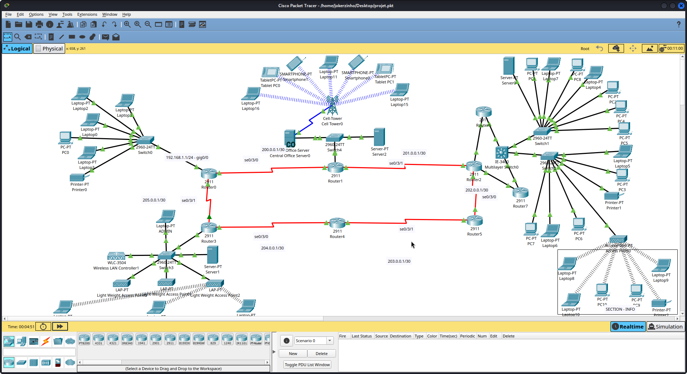

# architecture-reseau-hsrp-ospf
# Architecture Réseau Multi-Sites Haute Disponibilité & Sans-Fil (Cisco)

Conception, configuration et déploiement d'une infrastructure réseau complète sous **Cisco Packet Tracer** intégrant le routage dynamique, la redondance de passerelle, la segmentation VLAN et un réseau sans-fil centralisé.

## Aperçu de la Topologie


## Technologies & Protocoles Déployés
* **Routage Dynamique :** OSPF (Area 0) avec propagation de route par défaut (`default-information originate`) et sécurisation des interfaces passives.
* **Haute Disponibilité (FHRP) :** Protocole **HSRP** entre `Router 6` (Actif, priorité 120, `preempt`) et `Router 7` (Standby, priorité 100) avec IP virtuelle `172.16.10.3`.
* **Commutation & VLAN :** Architecture **VTP** (Mode Serveur sur le Switch Multilayer, Mode Client sur les commutateurs d'accès), liens Trunk 802.1Q et *Router-on-a-Stick*.
* **Services Réseau :** Serveur **DHCP** intégré sur `Router 0` avec exclusion d'adresses.
* **Infrastructure Sans-Fil (WLAN) :** Déploiement d'un contrôleur **WLC** et points d'accès configurés avec deux SSID dédiés (`SECTION-INFO` et `PUBLIC-MATH`).

---

## Configurations Cisco IOS

### 1. Cœur de Réseau & Routage OSPF (`Router 0` à `Router 5`)
<details>
<summary>Cliquez pour afficher les configurations des routeurs d'interconnexion</summary>

```ios
! --- ROUTER 0 (DHCP & Interconnexion) ---
enable
configure terminal
interface Serial0/3/0
 ip address 200.0.0.1 255.255.255.252
 no shutdown
interface Serial0/3/1
 ip address 205.0.0.1 255.255.255.252
 no shutdown
interface GigabitEthernet0/0
 ip address 192.168.1.1 255.255.255.0
 no shutdown
ip dhcp excluded-address 192.168.1.1
ip dhcp pool LAN
 network 192.168.1.0 255.255.255.0
 default-router 192.168.1.1
 dns-server 8.8.8.8

! --- ROUTER 1 ---
enable
configure terminal
interface Serial0/3/0
 ip address 200.0.0.2 255.255.255.252
 no shutdown
interface Serial0/3/1
 ip address 201.0.0.1 255.255.255.252
 no shutdown
interface GigabitEthernet0/0
 ip address 192.168.2.1 255.255.255.0
 no shutdown

! --- ROUTER 2 (Passerelle OSPF) ---
enable
configure terminal
interface Serial0/3/1
 ip address 201.0.0.2 255.255.255.252
 no shutdown
interface Serial0/3/0
 ip address 202.0.0.1 255.255.255.252
 no shutdown
interface GigabitEthernet0/0
 ip address 220.0.0.1 255.255.255.252
 no shutdown
interface GigabitEthernet0/1
 ip address 221.0.0.1 255.255.255.252
 no shutdown
router ospf 1
 network 201.0.0.0 0.0.0.3 area 0
 network 202.0.0.0 0.0.0.3 area 0
 network 220.0.0.0 0.0.0.3 area 0
 network 221.0.0.0 0.0.0.3 area 0
 passive-interface Serial0/3/1
 passive-interface Serial0/3/0
 default-information originate

! --- ROUTER 3, 4 & 5 (Backbone & Accès WLC) ---
! Router 5
interface Serial0/3/0
 ip address 202.0.0.2 255.255.255.252
 no shutdown
interface Serial0/3/1
 ip address 203.0.0.1 255.255.255.252
 no shutdown

! Router 4
interface Serial0/3/1
 ip address 203.0.0.2 255.255.255.252
 no shutdown
interface Serial0/3/0
 ip address 204.0.0.1 255.255.255.252
 no shutdown

! Router 3
interface Serial0/3/0
 ip address 204.0.0.2 255.255.255.252
 no shutdown
interface Serial0/3/1
 ip address 205.0.0.2 255.255.255.252
 no shutdown
interface GigabitEthernet0/0
 ip address 10.0.0.1 255.0.0.0
 no shutdown
```
</details>

### 2. Redondance HSRP & Router-on-a-Stick (`Router 6` & `Router 7`)
```ios
! --- ROUTER 6 (Passerelle HSRP Active) ---
interface GigabitEthernet0/0
 ip address 220.0.0.2 255.255.255.252
 no shutdown
interface GigabitEthernet0/1
 no shutdown
interface GigabitEthernet0/1.10
 encapsulation dot1Q 10
 ip address 172.16.10.1 255.255.0.0
 standby 1 ip 172.16.10.3
 standby 1 preempt
 standby 1 priority 120
router ospf 1
 network 220.0.0.0 0.0.0.3 area 0
 network 172.16.0.0 0.0.255.255 area 0

! --- ROUTER 7 (Passerelle HSRP Standby) ---
interface GigabitEthernet0/1
 ip address 221.0.0.1 255.255.255.252
 no shutdown
interface GigabitEthernet0/0
 no shutdown
interface GigabitEthernet0/0.10
 encapsulation dot1Q 10
 ip address 172.16.10.2 255.255.0.0
 standby 1 ip 172.16.10.3
 standby 1 preempt
 standby 1 priority 100
router ospf 1
 network 221.0.0.0 0.0.0.3 area 0
 network 172.16.0.0 0.0.255.255 area 0
```

### 3. Commutation VTP, VLAN & Infrastructure Sans-Fil
```ios
! --- MULTILAYER SWITCH 0 (VTP Server) ---
vtp mode server
vtp domain lo
vlan 10
 name vlan10
interface range GigabitEthernet1/1-10
 switchport mode trunk
 switchport trunk allowed vlan 10

! --- SWITCH 1 & SWITCH 2 (VTP Clients) ---
vtp mode client
vtp domain lo
interface range FastEthernet0/1-24
 switchport mode access
 switchport access vlan 10
interface GigabitEthernet0/2
 switchport mode access
 switchport access vlan 10
```
* **Point d'Accès Autonome (`AP_PT`) :** SSID `SECTION-INFO` (WPA2)
* **Contrôleur Sans-Fil (`WLC`) :** SSID `PUBLIC-MATH` administré via le poste `ADMIN LAPTOP`
